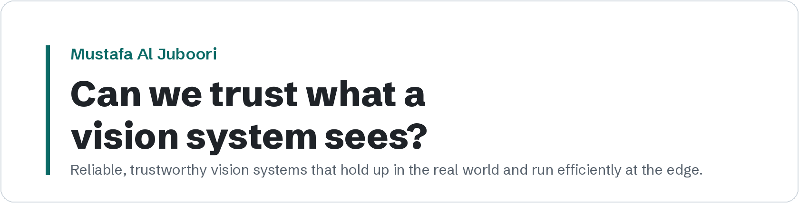

<picture>
  <source media="(prefers-color-scheme: dark)" srcset="assets/banner-dark.png">
  
</picture>

**Computer & AI Engineering @ UAEU · Research Assistant, Autonomous Systems Lab · Vision-language models, reliable multimodal AI, edge AI for UAVs and agriculture**

Undergraduate at United Arab Emirates University (CGPA 3.95/4.0, graduating May 2027) and visiting researcher at the eBRAIN Lab, NYU Abu Dhabi.

I work on **vision-language models that can be trusted outside the benchmark**: models that answer with evidence, check each other and know when to abstain, deployed where errors are costly, on drones, in farms and on coral reefs.

**Research interests:** efficient and reliable computer vision · multimodal vision-language reasoning · agentic AI · robust perception · edge AI

---

### Selected publications

- **A multi-agent vision-language debate framework for zero-shot crop disease diagnosis** 
  **M. Al Juboori**, Z. Abbas, Z. Al Aghbari, F. Ullah, M. Ur Rehman. *Frontiers in Plant Science* 17, 2026. 
  [Paper](https://doi.org/10.3389/fpls.2026.1890016) · [Code](https://github.com/mustafanfj/vida-panda-crop-disease)
- **A stacking ensemble framework for underwater coral health assessment using multi-domain handcrafted features** 
  **M. Al Juboori** *et al.* *CAISAIS 2026*, IEEE, accepted.
- **Underwater image quality assessment using novel domain-specific features and a neural network regressor** 
  **M. Al Juboori** *et al.* *ICATCICT 2026*, Springer, accepted.
- **CoralAgent-TRACE: An evidence-grounded agentic framework for coral reef health assessment and VQA** 
  **M. Al Juboori**, Z. Abbas, M. Ur Rehman. *Frontiers in Marine Science*, under review. 
  [Code](https://github.com/mustafanfj/CoralAgent-TRACE)
- **SemUAV-VLM: Deadline-aware semantic communication for UAV vision over constrained wireless links** 
  **M. Al Juboori**, T. Almazrouei, F. Ullah, H. El-Sayed, M. Ur Rehman. *IEEE Open Journal of Vehicular Technology*, under review. 
  [Code](https://github.com/mustafanfj/SemUAV-VLM)
- **AeroVerify-VLM**: training-free, evidence-grounded VQA on UAV imagery with small VLMs 
  **M. Al Juboori** *et al.* *IEEE Open Journal of Vehicular Technology*, under review. 
  [Code](https://github.com/mustafanfj/AeroVerify-VLM)

Full list, including four more manuscripts under review, on my [website](https://mustafanfj.github.io/#publications).

---

### Featured research

<table>
<tr>
<td width="50%" valign="top">

<a href="https://github.com/mustafanfj/CoralAgent-TRACE"><b>CoralAgent-TRACE</b></a> 
Plans question-specific tools for coral reef VQA and has an independent verifier check every answer. +3.7 points over GPT-5 zero-shot on CoralVQA.

</td>
<td width="50%" valign="top">

<a href="https://github.com/mustafanfj/AeroVerify-VLM"><b>AeroVerify-VLM</b></a> 
Fuses evidence sources by learned reliability and abstains when unsure. Up to +7.0 points with no fine-tuning, and false "yes" answers cut from 21.8% to 0%.

</td>
</tr>
<tr>
<td width="50%" valign="top">

<a href="https://github.com/mustafanfj/SemUAV-VLM"><b>SemUAV-VLM</b></a> 
A drone sends the smallest message that still lets the ground act in time: a 1 kB alert with 105× fewer bytes than the best image.

</td>
<td width="50%" valign="top">

<a href="https://github.com/mustafanfj/vida-panda-crop-disease"><b>VIDA + PANDA</b></a> · <i>Frontiers in Plant Science</i> 
Seven VLMs diagnose crop disease independently, then debate by name and may only change a verdict with new visual evidence. Debate lifts the weakest panel member by 12.1 points.

</td>
</tr>
</table>

---

### Research experience

- **Visiting Researcher**, eBRAIN Lab, NYU Abu Dhabi (Jun 2026 – present), with Prof. Muhammad Shafique. Robustness of compressed perception models under adverse conditions.
- **Research Assistant**, Autonomous Systems Lab, College of Computing and AI, UAEU (Jan 2026 – present), with Dr. Mobeen Ur Rehman.
- **Research Intern**, UAEU SURE+ program (Apr 2025 – Jan 2026), with Dr. Abdulmalik Al Warafy. Deep RL for secure UAV networks.
- **Research Intern**, AIRoCS Group, MBZUAI (Jun – Aug 2025), with Dr. Abdalla Swikir. Provably safe learned policies on a 7-DoF Franka Emika arm.

### Funding and awards

- 750,000+ AED in research funding, including 650,000 AED with Silal (Agri-Sensei) and 100,000 AED from the R2C program (CropSage)
- 1st place and 150,000 AED at the P2M Startup Competition 2025, as co-founder and CTO of Dovvi
- Chancellor's Scholarship for Elite Students · Dean's List

---

**Tools**

Also Hugging Face, YOLO, SAM, LoRA, NVIDIA Jetson, ESP32 and nRF52840.
